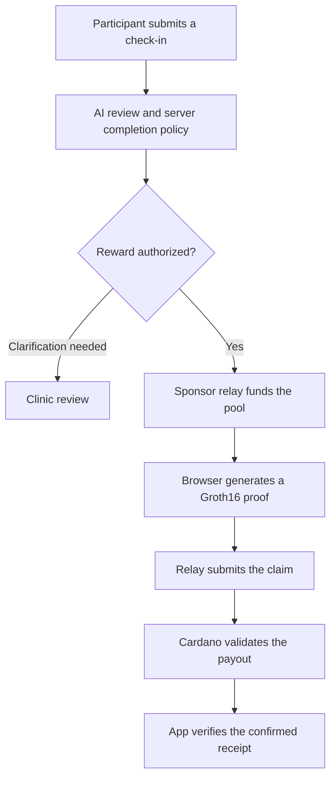

<div align="center">

# careloop.

### Research check-ins. Verifiable rewards.

A research follow-up prototype that combines program-specific questionnaires,
AI-assisted review and ZK-gated rewards on Cardano Preprod.


**[Open the demo](https://careloop-study-prototype.perasperaadastra3008.chatgpt.site/)**
&nbsp; · &nbsp; **[Watch the 2:28 demo](docs/demo/Careloop-Demo.mp4)**
&nbsp; · &nbsp; **[Run locally](#quick-start-on-your-own-computer)**

[Architecture](#technology-at-a-glance) · [How ZK works](#zero-knowledge-in-careloop) · [Transaction evidence](#verification-and-existing-evidence) · [Submission](docs/DEVFOLIO.md)

</div>

---

Careloop connects research participants, clinics and sponsors. Participants complete regular check-ins through a care journey. Clinics configure questionnaires and resolve exceptions. Sponsors fund analysis and participant rewards, with actual payment receipts available on Cardano.

The application checks report completion off chain. A browser-generated proof then allows the reward contract to verify approved membership and payout terms without receiving the questionnaire.

> **Demo scope** — Fictional answers and disposable Preprod assets only. The AI has no clinical validation, and the service sends no medical alerts. The backend and external AI provider process report answers.

**For judges:** [submission description and links](docs/DEVFOLIO.md) · [requirements checklist](docs/SUBMISSION.md#requirement-checklist) · [paid AI job evidence](docs/evidence/README.md).

---

## Open the current demo

**Live link: https://careloop-study-prototype.perasperaadastra3008.chatgpt.site/**

[Watch or download the recorded demo — 2:28](docs/demo/Careloop-Demo.mp4) · [Video details and submission steps](docs/demo/README.md)

Use **Try participant demo**, **Try clinic demo**, or **Try sponsor demo**. In the demo, **View as** switches roles. **Demo tools → Choose participant** offers Alex, Maya and Noah already enrolled, and Sam registered with a wallet but awaiting enrollment. Wallet addresses are saved in their profiles; they do not need to enter an address for each report.

The public demo runs its website and database online. Visitors only need a browser. **Paid AI requires the operator’s Masumi report worker and Payment Service; live rewards require the funded sponsor relay.** These workers currently run on the operator’s computer, so it must remain online. Use **Demo tools → Check payment service → Check service** to inspect its status; a queued reward is not a confirmed payment.

For an independent installation, use the fresh-clone instructions below. They create your own local database, relay token and disposable sponsor wallet. No original developer credentials or private files are needed. The [Masumi report worker](integrations/masumi/README.md#connect-website-reports-to-paid-analysis) has its own payment-service setup. A fresh clone defaults to direct model analysis until paid mode is explicitly enabled.

---

## Technology at a glance

| Layer | Technology | Role in Careloop |
| --- | --- | --- |
| Settlement | **Cardano Preprod** | Public evidence of funding, contract state and participant payouts |
| Reward contract | **Aiken / Plutus V3** | Enforces proof verification, payout terms and the continuing pool state |
| Private eligibility | **Groth16 over BLS12-381** | Proves membership in an approved batch using a secret retained in the participant browser |
| Circuit | **Circom + Poseidon** | Constrains the commitment, Merkle path, scoped nullifier and recipient binding |
| Transaction construction | **Lucid Evolution** | Builds pool-funding and claim transactions for the sponsor relay |
| Paid AI | **Masumi escrow** | Tracks sponsored analysis funding, result commitment and seller settlement |
| Report review | **Gemini + application policy** | Supplies analysis evidence and applies completion rules before reward authorization |
| Application data | **Workers / D1; Node.js / SQLite locally** | Stores accounts, programs, reports and durable payment jobs |

### Report-to-reward architecture



The diagram shows the participant reward flow. Paid analysis uses a separate Masumi escrow flow, described below. [Full architecture and trust boundaries](docs/ARCHITECTURE.md).

## Zero knowledge in Careloop

The proof establishes that the participant holds the secret for an enrollment included in an approved Merkle root, scoped to the program, reporting period and reward. It also binds the claim to the recipient's payment key.

| Boundary | What it contains |
| --- | --- |
| **Private witness in the browser** | Enrollment secret, three Merkle siblings and three path directions |
| **Public circuit inputs** | `root`, `nullifier`, `program`, `period`, `amount`, `recipient`, `domain`, `binding` |
| **On-chain verification** | Groth16 proof, expected pool terms, recipient output and an unused nullifier |

**Commitment.** Poseidon derives the enrollment commitment from the local secret. The circuit reconstructs the approval root from the private membership path.

**Nullifier.** A deterministic marker derived from the secret and scope lets the pool reject a repeated claim while the secret stays private.

**Recipient binding.** The circuit binds the nullifier to the recipient. The spending validator also requires the matching payment output and preserves the remaining pool value and state NFT.

**Privacy boundary.** The public chain receives the proof, public inputs and transaction data. The backend stores the report and the external model provider receives its answers. Addresses, amounts and timing remain public. Proof verification establishes authorized membership; report truth, clinical safety and global person uniqueness require other controls.

The current circuit uses a depth-three tree with eight leaves, including synthetic entries, and an experimental single-machine trusted setup.

Explore the implementation: [Circom circuit](zk/reward.circom) · [browser proof core](src/zk-core.js) · [Aiken validator](contracts/validators/rewards.ak) · [pool state](contracts/lib/careloop/state.ak).

---

## The real workflow

1. A participant joins a clinic program with its invitation code and creates a private enrollment secret in the browser. The server stores the public commitment.
2. The participant submits a check-in. The server saves its original answers and program configuration, checks the reporting period and rejects a duplicate submission.
3. Gemini analyzes the report. Server policy decides whether completion qualifies for a reward or needs clarification. A successful model response is not, by itself, permission to spend funds. Model failure or unreliable output remains visible and does not silently pass.
4. An authorized submission is queued for the sponsor relay. The bounded relay funds a real **20-test-ADA smart-contract pool**, observes confirmation, and publishes its public deployment metadata. A held report waits for clinic review.
5. The participant browser generates a Groth16 proof using its local enrollment secret and selected payout address. The sponsor relay pays the transaction fees and submits a claim that transfers exactly **2 test ADA** to that address.
6. The UI separates approval, funding, proof preparation, transaction submission and **confirmed payment**. Its explorer link points to the transaction for that report. A fake database flag or an unrelated transaction cannot establish payment.

Clinical review is separate from reward eligibility. Concerning symptoms may require clinical follow-up without automatically removing a completion reward. AI cannot diagnose, determine that a participant is safe, or notify a doctor in this demo.

This workflow requires the sponsor relay to be online and funded. Network confirmation is asynchronous; “submitted” does not mean “paid.” See [the live walkthrough](docs/LIVE-DEMO.md) for the presentation sequence and recovery behavior. **Demo tools → Payment walkthrough** is an educational illustration; a report's live payment view and matching confirmed transaction provide payment evidence.

---

## Why blockchain is useful here

- **Shared payment evidence.** A sponsor, participant or clinic can independently inspect actual contract funding, remaining funds and payouts on Cardano. They do not have to accept a clinic's database entry as proof that money was paid.
- **Rules enforced at settlement.** The contract checks the approved root, program, period, recipient payment key, reward amount and unused nullifier. A matching proof releases 2 test ADA and preserves the remaining pool state. Replaying the same claim cannot withdraw again from that pool.
- **Less payment administration for the clinic.** The sponsor funds the contract and covers transaction fees. An ordinary qualifying report can be paid automatically to the participant's saved wallet; the clinic resolves exceptions rather than manually sending every reward.
- **Eligibility verification without public questionnaires.** The browser proves membership in an approved batch without revealing its enrollment secret or Merkle path. The chain verifies the proof without receiving the medical answers.

The settlement record is decentralized; **the whole application is not serverless**. Accounts, reports, AI calls, approval policy and the payment queue still use a hosted backend. The current sponsor relay is another availability dependency.

Likewise, **ZK does not currently mean “only the clinic knows your data.”** The backend stores reports and the external AI provider receives their answers. The freely switchable demo roles do not provide production isolation between sponsor and clinic. ZK protects the private proof inputs from the public chain; it does not encrypt the report database.

The broader product goal is for participants to see a clinic's sponsor allocation without the sponsor seeing clinical answers. Today, sponsor and clinic panels share the app's budget ledger; participants see their own rewards and can inspect actual on-chain funding. There is no participant-facing clinic-wide allocation panel yet. App credit allocations are off-chain and are not independently proven by Cardano. [Read the precise architecture and privacy boundaries](docs/ARCHITECTURE.md).

---

## Two payment purposes, one network

| Flow | Who funds it | What receives payment | Implementation |
| --- | --- | --- | --- |
| Participant completion reward | Sponsor | Participant payout address | Custom Aiken/Plutus V3 pool + browser Groth16 proof |
| Paid questionnaire-analysis job | Sponsor/buyer | AI-service seller | Masumi escrow on Cardano Preprod |

With `PAID_AI_ENABLED=true`, submitting a report automatically queues one immutable Masumi job against the sponsor’s allocated AI budget. The participant does not request credits or approve a payment. If the sponsor budget or job allowance is exhausted, the report remains saved and the worker retries automatically once funding is available. The worker purchases escrow, waits for confirmed funding, runs Gemini on the saved report/program, commits the result hash and supplies the matching result to completion policy only after its transaction is confirmed. The UI tracks final seller settlement separately. Refreshing cannot purchase a second job. Existing direct analyses remain labeled as such and are not retroactively billed. [Worker setup and recovery](integrations/masumi/README.md#connect-website-reports-to-paid-analysis).

---

## Verification and existing evidence

[Public transaction evidence](docs/preprod-demo.json) records completed tests on **Cardano Preprod, network magic 1**:

- **Masumi service payment:** seller received 1 test USDM. [Confirmed withdrawal](https://preprod.cardanoscan.io/transaction/e4fcfed76fe2b334fd2aa6d1f8531036513f31e5ec454a64cc8ad0d87a338ef1).
- **Earlier patient reward:** real Groth16 proof, 2 test ADA paid, pool changed from 20 to 18 ADA and recorded its nullifier. [Funding](https://preprod.cardanoscan.io/transaction/f7b17e0f0f34ad3f8406c9f22e21e90c9c5d0c1fc33468ae32217013f88dbc13) · [Claim](https://preprod.cardanoscan.io/transaction/3cdc05fd37d24ce89529db27057ffdcd44b9eef40269888cc3ebf1faf6fa0b10).

An automatic website run is also recorded in [live-form-payment.json](docs/live-form-payment.json): [funding](https://preprod.cardanoscan.io/transaction/3ab289b65292f64d19211436b9c417c725d332431dad72c9bd1ff5a67f6e3bb1) and [2-test-ADA claim](https://preprod.cardanoscan.io/transaction/822634daddc045a367669ebba5d6c07af7d3ec071c984cabb1c26c27e479f2e5).

Those historical receipts came from dedicated test wallets. They are **not** proof that a newly submitted website report has been paid. Use that report's fresh confirmed transaction for the live demonstration.

```sh
npm test
node --test integrations/masumi/*.test.mjs
node scripts/test-zk.mjs
cd contracts
../node_modules/.bin/aiken check -m 'careloop/fixtures.{..}' -m 'careloop/state.{..}' -m 'rewards.{..}'
```

Tests cover authorization, server persistence, duplicate reports, model evidence validation, private-proof inputs, transaction-state verification and actual Plutus evaluation in the Lucid emulator. Unit/emulator success is separate from live network confirmation.

---

## Quick start on your own computer

Requirements: Git, npm and **Node.js 24.5+** (tested with Node 26). From any directory where you keep projects:

```sh
git clone https://github.com/IlyaKats2005/Careloop.git
cd Careloop
npm ci
npm run setup
```

Open the generated `.env` in your editor and set **your own `GEMINI_API_KEY`**. Then:

```sh
npm run build
npm run dev
```

Open **http://localhost:8787**. Choose a demo role to try registration, enrollment, questionnaires, clinic review and sponsor budgets. `npm run dev` loads `.env`; local records persist in `.local/dev-data.sqlite`. No PostgreSQL or hosted Careloop account is needed.

`npm run setup` generates a random relay token and an **unfunded** Preprod sponsor wallet, prints only its public receiving address, and leaves existing configuration untouched if rerun. Configuration and wallet files are ignored by Git. Without a model key, the interface can be explored but real AI analysis cannot complete. Without a funded relay, no testnet reward is paid.

To run **real participant payments**, follow [funding and relay setup](docs/RUNNING.md#enable-real-preprod-rewards), then run these from a second terminal in the same clone:

```sh
npm run relay:check
npm run relay
```

To check the reward contracts and real ZK proofs **without API keys, a funded wallet or network payments**:

```sh
npm test
npm run test:masumi
```

The application tests include a real Groth16 proof and serialized Plutus contract execution in the Lucid emulator. Masumi tests use fixtures; reproducing an actual paid AI job requires [your own Masumi setup](integrations/masumi/README.md). See [the full run guide](docs/RUNNING.md) for account setup, wallet funding, troubleshooting and optional hosting.

---

## Demo operations

<details>
<summary>Demo workspace, budgets and recording guides</summary>

Open **Sponsor** for actual Masumi/test-USDM and reward/test-ADA totals with report-specific explorer receipts. **Demo credit controls · off-chain** contains the optional clinic allocation controls. Each new demo starts with 1,000 app credits: 750 unallocated, 200 for rewards and 50 for AI. Clinic balances and funding activity update automatically. **Refresh** updates the current reports and balances without resetting the run. A browser reload resumes the same workspace, participant, program and saved report. Only **Demo tools → Restart demo**, after confirmation, restores the starting balances and the three-enrolled/one-unenrolled cohort. Navigation is stored for this tab; questionnaire drafts remain in memory only. These app credits are separate from real test ADA, model-provider billing and the live payment allowance, which are not reset.

Open **Demo tools → Check payment service → Check service** to check the sponsor heartbeat and remaining payment allowance. Check-in includes enrollment creation and private recovery controls before submission. **My rewards** and **My reports** update automatically and can generate the participant's pending proof while open. Historical receipts are labeled separately from the current report's payment.

- [Always-on worker deployment](deploy/README.md): Docker Compose package with persistent journal, restart policy and heartbeat health check. Requires a separately provisioned host.
- [Ready-to-record video transcript](docs/VIDEO-TRANSCRIPT.md): 278 words, a timed screen sequence and Mac microphone setup.
- [Live rehearsal guide](docs/DEMO-REHEARSAL.md): preparation, successful payments and held reports.

</details>

---

## Run the sponsor relay

<details>
<summary>Sponsor relay operations and spending limits</summary>

The relay is the sponsor's signing process. For a local installation, the generated `.env` points to **your own app at `http://localhost:8787`**, with the same private relay token used by the local API. No access to the shared live demo is required. [The run guide](docs/RUNNING.md#enable-real-preprod-rewards) covers funding, separate collateral, existing wallets and deployment to your own host.

Keep one relay running for the wallet and preserve `.local/sponsor-relay/` across restarts. It contains signed transaction journals used to reconcile uncertain submissions. `npm run relay:check` reads wallet and server status without sending transactions; it does not simulate a spend or guarantee sufficient collateral. `npm run relay` processes approved jobs and can spend disposable Preprod assets. The participant keeps My rewards, My reports or the report open until its browser-generated proof has been sent.

The example allows **4 jobs / 100 test ADA**. Both the server job allowance and relay spending limits apply. Restarting the demo only resets app data and app credits. Each report currently receives a separate 20-test-ADA pool; one claim pays 2 and leaves 18. There is no refund/close path. These locked funds and fees require real testnet liquidity independently of the app's displayed credits.

</details>

---

## Data and privacy

- Submitted answers, program snapshots, AI output, clinic decisions and public reward metadata live in the server database. A fresh sign-in can recover them on another device.
- Unsaved form drafts remain in memory. Private guest workspaces are associated with an `HttpOnly` cookie for seven days.
- Enrollment secrets and recovery files stay in the participant browser. Download a recovery file before switching devices or closing a tab with reward state. Signing in elsewhere does not recover that secret.
- The public chain receives proof/public inputs and transaction information, not the questionnaire or enrollment secret. Addresses, amounts, timing, program/period and nullifiers are public and may be linkable.
- The hosting operator can link accounts to stored reports. This email-account prototype does **not** guarantee that only a clinic can identify a participant.
- The demo's Sponsor view is a simulation within the same workspace, not a separate confidentiality boundary. Its workspace API can return report records even though the sponsor screen displays budgets. Do not use it for real clinical data.
- Fictional answers are sent to an external model provider. Do not enter real medical information.

---

## Implementation map

| Component | Source |
| --- | --- |
| Participant/clinic UI and report state | `public/app.js` |
| Shared records and authorization | `src/data-api.js`, `src/auth.js`, `drizzle/` |
| AI adapter and response validation | `src/api.js` |
| Sponsor transaction worker | `scripts/sponsor-relay.mjs` |
| Browser enrollment/proof/payment state | `src/privacy-ui.js`, `src/zk-core.js`, `src/reward-status.js` |
| Cardano transactions and wallet integration | `src/cardano.js`, `src/cardano-wallet.js` |
| Circuit and validator | `zk/reward.circom`, `contracts/validators/rewards.ak` |
| Paid Masumi agent | `integrations/masumi/` |
| Educational and live blockchain views | `public/blockchain.js` |

---

## Limits

The AI is an untrained Gemini demo with per-program instructions, not a trained or clinically validated specialist. Clinic enrollment and identity verification remain demonstration controls. The database blocks repeated submissions for an enrollment/program/period; the contract blocks nullifier reuse within its pool. Creating another account or unrelated pool is not globally prevented by ZK.

The proof system uses an experimental single-machine development setup. The depth-3 tree includes synthetic entries; batches and one-period pools are not a production scalability design. There is no refund path, production security audit, email verification or password reset. No doctor is automatically contacted. Keep the demonstration to fictional inputs and test assets.

---

## Source provenance and licenses

<details>
<summary>Upstream sources, licenses and private-file handling</summary>

Careloop's own source is GPL-3.0-or-later. Existing upstream files retain their notices.

- Poseidon BLS12-381 circuit: Cardano Foundation `bls`, commit `3f43b60c92beb98a43331a00ae6a5ec1316acce1`; notice retained in `zk/vendor/poseidon_bls12_381.circom`.
- Vendored Aiken stdlib v3.1.0, commit `7d5cee54b2bb4eea211ae3bd806c7c39e5fd899d`; `contracts/STDLIB-LICENSE`.
- snarkjs 0.7.6: GPL-3.0; `public/SNARKJS-LICENSE`.
- Masumi integration adapted from the [official TUM quickstart](https://github.com/masumi-network/tum-hackathon-quickstart), with Careloop's fictional-questionnaire client, payment verification and recovery logic. See its integration README for provenance and dependencies.

Do not commit environment files, runtime journals, account credentials, wallet seeds, private recovery files or database contents.

</details>
